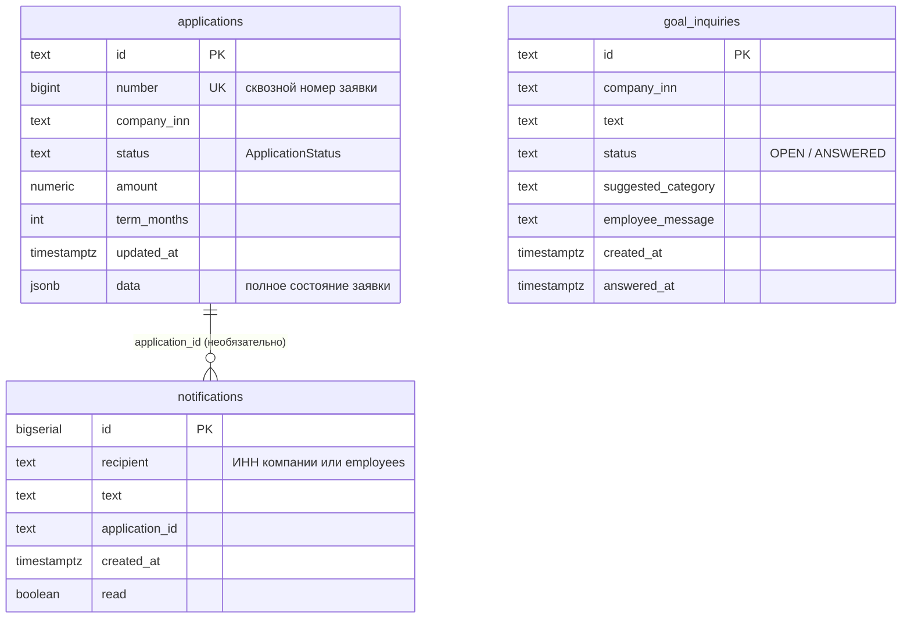

# data-model

БД: PostgreSQL 16. Миграции: `backend/src/main/resources/db/migration/` (Flyway, применяются при старте backend).

## Что где хранится

| Данные | Где |
|---|---|
| Заявки: цели, сумма, срок, шаг, ответы, список приложенных документов, отправленный расчёт, решение и причины, снимок банковских сведений, окончательное предложение, история событий | `applications`: поля для поиска в колонках, остальное в `data` (JSONB, формат — `LoanApplication.Snapshot`) |
| Уведомления клиенту и сотрудникам | `notifications` |
| Вопросы сотруднику по неясной цели «Другое» | `goal_inquiries` |
| Клиенты, карточки компаний, логины | не в БД: читаются из `data/demo-profiles/profiles.json` при старте, пароли хешируются (PBKDF2) в памяти |
| Сессии (токены входа) | в памяти backend: после перезапуска нужно войти заново |
| Файлы и версии документов | не в backend: `documents-service` (или секция `documents` в `profiles.json`) |
| Банковские сведения | не хранятся постоянно: запрашиваются у моков при отправке заявки, результат сохраняется в заявке как снимок |

Почему JSONB: заявка богатая (вложенные решения, история, снимки сведений) и меняется вместе с продуктом, при этом искать по ней нужно только по номеру, компании и статусу.
